# Risultati v2

Durata fisica T = 104.7197551. T = 20 × tau_s; tau_s = pi/(2*g_ref) = 5.235987756, g_ref = 0.3.

Ogni riga usa la propagazione continua del controllo con il filtro configurato.
P_target è la probabilità target; F_root = sqrt(P_target). Il reset dei qubit, se richiesto, entra in P_target.
Una soluzione non validata non è evidenza di vantaggio fisico. La convergenza dell'ottimizzatore è distinta dalla validazione numerica.
Le statistiche e il seed selezionato riguardano solo partenze casuali; i warm start sono separati.
La banda 99% è una diagnostica del segnale finito, non un limite spettrale imposto. Le fluenze non sono calore dissipato.

| Caso | Seed | P target | F radice | Purezza | Validato | Soglia raggiunta |
|---|---:|---:|---:|---:|---|---|
| 1q | 100 | 0.99917451 | 0.99958717 | 0.999103 | True | True |
| 1q | 101 | 0.99936532 | 0.99968261 | 0.999320 | True | True |
| 2q_normalized_independent | 100 | 0.99881763 | 0.99940864 | 0.998200 | True | True |
| 2q_normalized_independent | 101 | 0.99228105 | 0.99613305 | 0.988941 | True | True |

## 1q
Distribuzione sulle 2 pipeline raffinate: {"count": 2, "probability_mean": 0.9992699138472364, "probability_std_population": 9.540545508734954e-05, "probability_median": 0.9992699138472364, "probability_min": 0.999174508392149, "probability_max": 0.9993653193023238, "numerically_valid_count": 2, "validated_goal_count": 2, "validated_goal_fraction": 1.0, "probability_q25": 0.9992222111196927, "probability_q75": 0.9993176165747801, "selection_bias_top_only": false}.
Seed selezionato: 101. Selezione per costo continuo, dando precedenza alle soluzioni validate.
Probabilità target senza modulazione: 0.00000000.

### random — 100
Controlli numerici falliti: nessuno.
CRAB: Maximum number of function evaluations has been exceeded.. GRAPE: STOP: TOTAL NO. OF ITERATIONS REACHED LIMIT.
[Metadati completi](1q/seed_100/result.json)
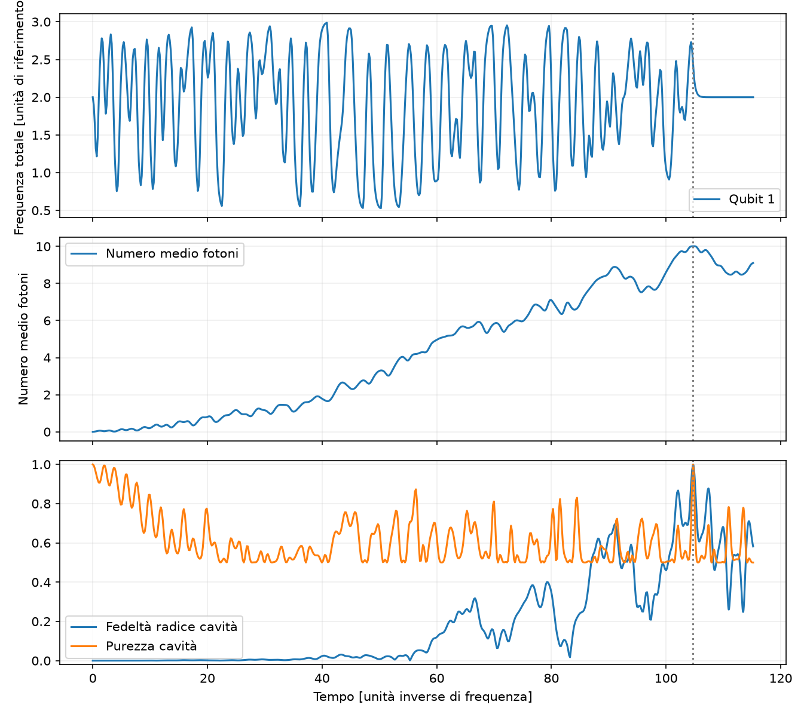
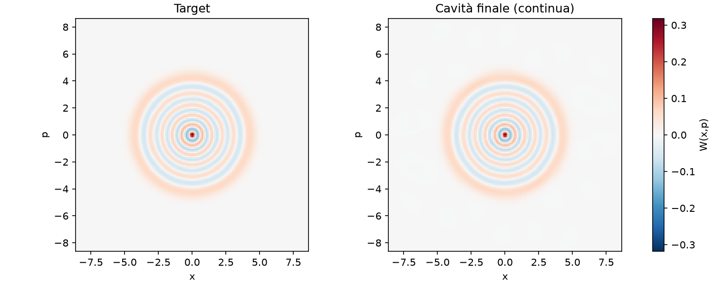
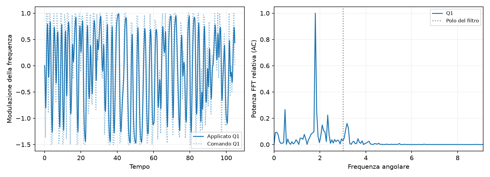
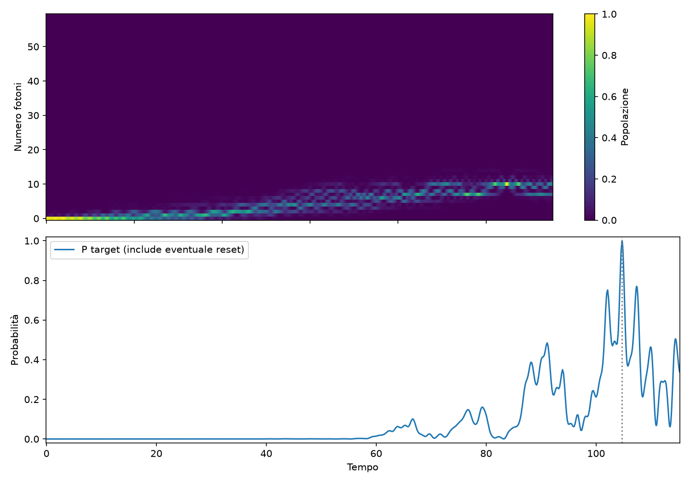

### random — 101
Controlli numerici falliti: nessuno.
CRAB: Maximum number of function evaluations has been exceeded.. GRAPE: STOP: TOTAL NO. OF ITERATIONS REACHED LIMIT.
[Metadati completi](1q/seed_101/result.json)
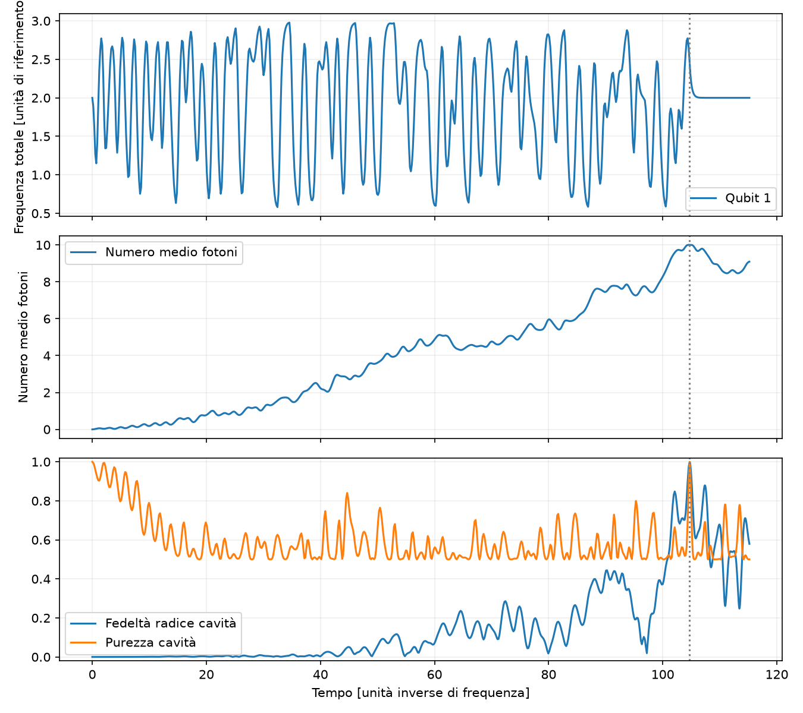

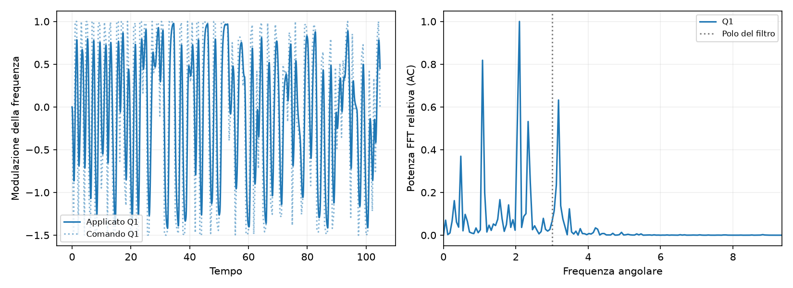

## 2q_normalized_independent
Distribuzione sulle 2 pipeline raffinate: {"count": 2, "probability_mean": 0.995549339064535, "probability_std_population": 0.0032682865255490023, "probability_median": 0.995549339064535, "probability_min": 0.992281052538986, "probability_max": 0.998817625590084, "numerically_valid_count": 2, "validated_goal_count": 2, "validated_goal_fraction": 1.0, "probability_q25": 0.9939151958017605, "probability_q75": 0.9971834823273096, "selection_bias_top_only": false}.
Seed selezionato: 100. Selezione per costo continuo, dando precedenza alle soluzioni validate.
Probabilità target senza modulazione: 0.00000000.

### random — 100
Controlli numerici falliti: nessuno.
CRAB: Maximum number of function evaluations has been exceeded.. GRAPE: STOP: TOTAL NO. OF ITERATIONS REACHED LIMIT.
[Metadati completi](2q_normalized_independent/seed_100/result.json)
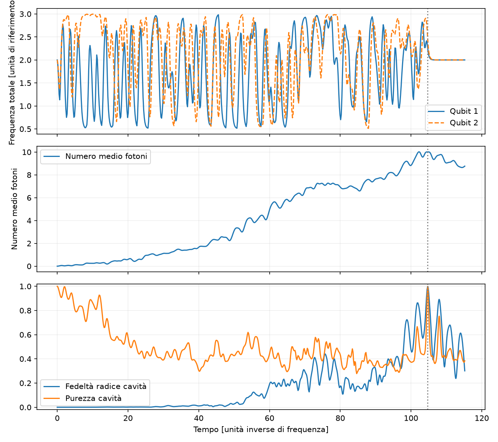
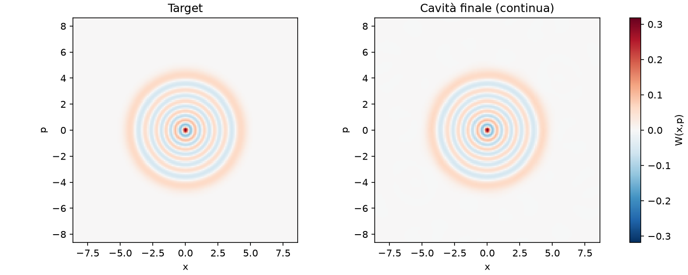
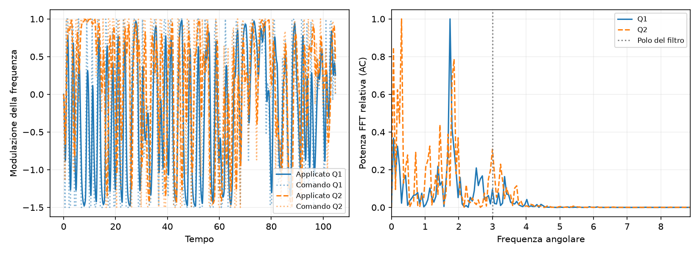

### random — 101
Controlli numerici falliti: nessuno.
CRAB: Maximum number of function evaluations has been exceeded.. GRAPE: STOP: TOTAL NO. OF ITERATIONS REACHED LIMIT.
[Metadati completi](2q_normalized_independent/seed_101/result.json)
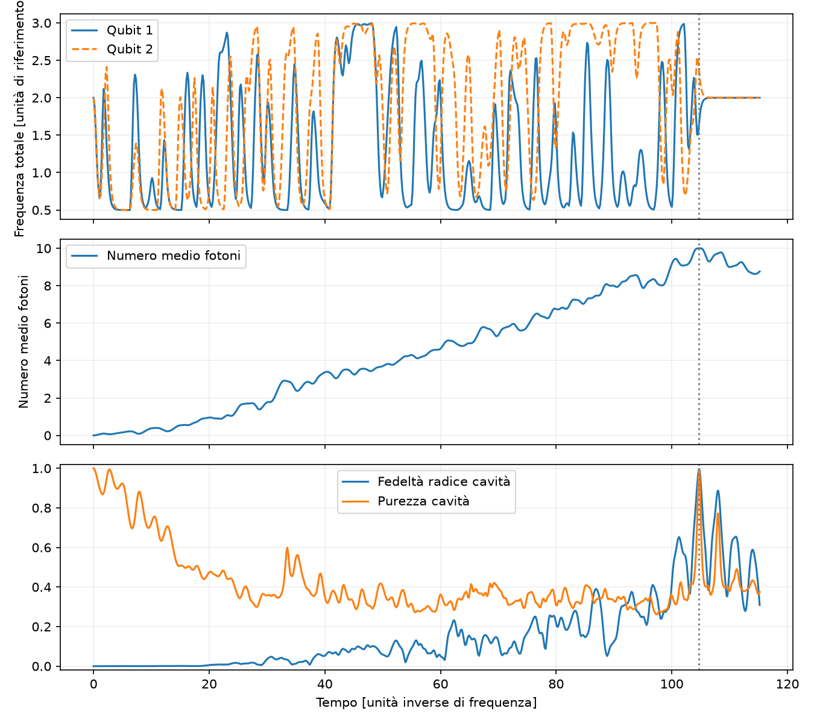
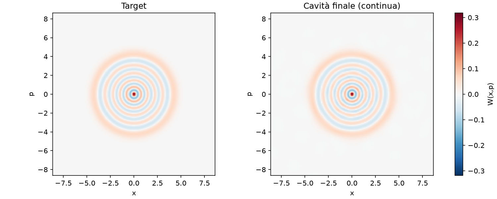
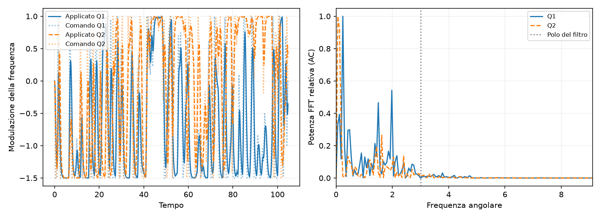
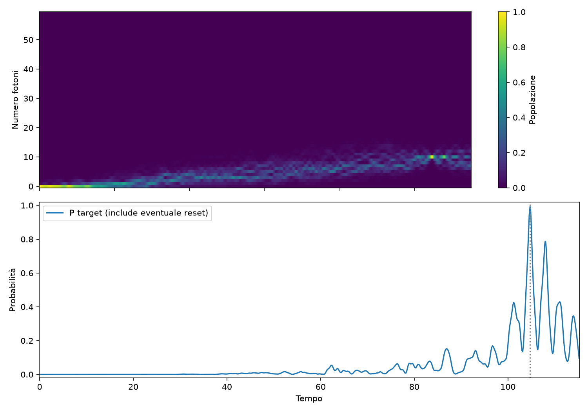
