# Risultati v2

Durata fisica T = 104.7197551. T = 20 × tau_s; tau_s = pi/(2*g_ref) = 5.235987756, g_ref = 0.3.

Ogni riga usa la propagazione continua del controllo con il filtro configurato.
P_target è la probabilità target; F_root = sqrt(P_target). Il reset dei qubit, se richiesto, entra in P_target.
Una soluzione non validata non è evidenza di vantaggio fisico. La convergenza dell'ottimizzatore è distinta dalla validazione numerica.
Le statistiche e il seed selezionato riguardano solo partenze casuali; i warm start sono separati.
La banda 99% è una diagnostica del segnale finito, non un limite spettrale imposto. Le fluenze non sono calore dissipato.

| Caso | Seed | P target | F radice | Purezza | Validato | Soglia raggiunta |
|---|---:|---:|---:|---:|---|---|
| 1q | 100 | 0.99941699 | 0.99970845 | 0.999599 | True | True |
| 1q | 101 | 0.99907208 | 0.99953593 | 0.998896 | True | True |
| 2q_normalized_independent | 100 | 0.99879717 | 0.99939840 | 0.998142 | True | True |
| 2q_normalized_independent | 101 | 0.99548545 | 0.99774017 | 0.993574 | True | True |

## 1q
Distribuzione sulle 2 pipeline raffinate: {"count": 2, "probability_mean": 0.9992445350595719, "probability_std_population": 0.00017245540080368382, "probability_median": 0.9992445350595719, "probability_min": 0.9990720796587682, "probability_max": 0.9994169904603756, "numerically_valid_count": 2, "validated_goal_count": 2, "validated_goal_fraction": 1.0, "probability_q25": 0.9991583073591701, "probability_q75": 0.9993307627599737, "selection_bias_top_only": false}.
Seed selezionato: 100. Selezione per costo continuo, dando precedenza alle soluzioni validate.
Probabilità target senza modulazione: 0.00000000.

### random — 100
Controlli numerici falliti: nessuno.
CRAB: Maximum number of function evaluations has been exceeded.. GRAPE: STOP: TOTAL NO. OF ITERATIONS REACHED LIMIT.
[Metadati completi](1q/seed_100/result.json)
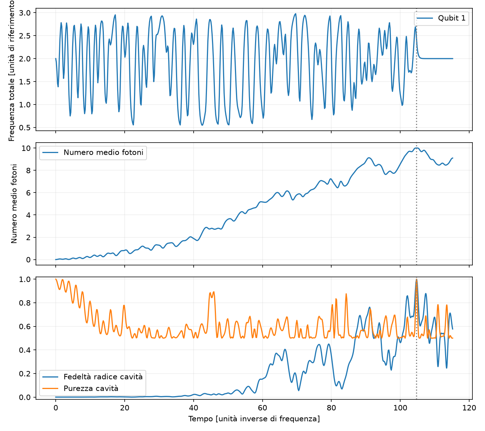

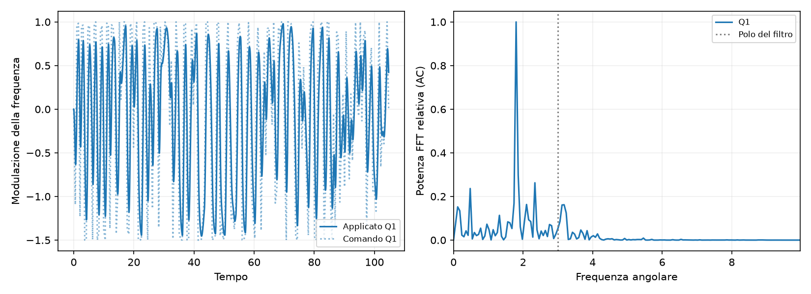

### random — 101
Controlli numerici falliti: nessuno.
CRAB: Maximum number of function evaluations has been exceeded.. GRAPE: STOP: TOTAL NO. OF ITERATIONS REACHED LIMIT.
[Metadati completi](1q/seed_101/result.json)
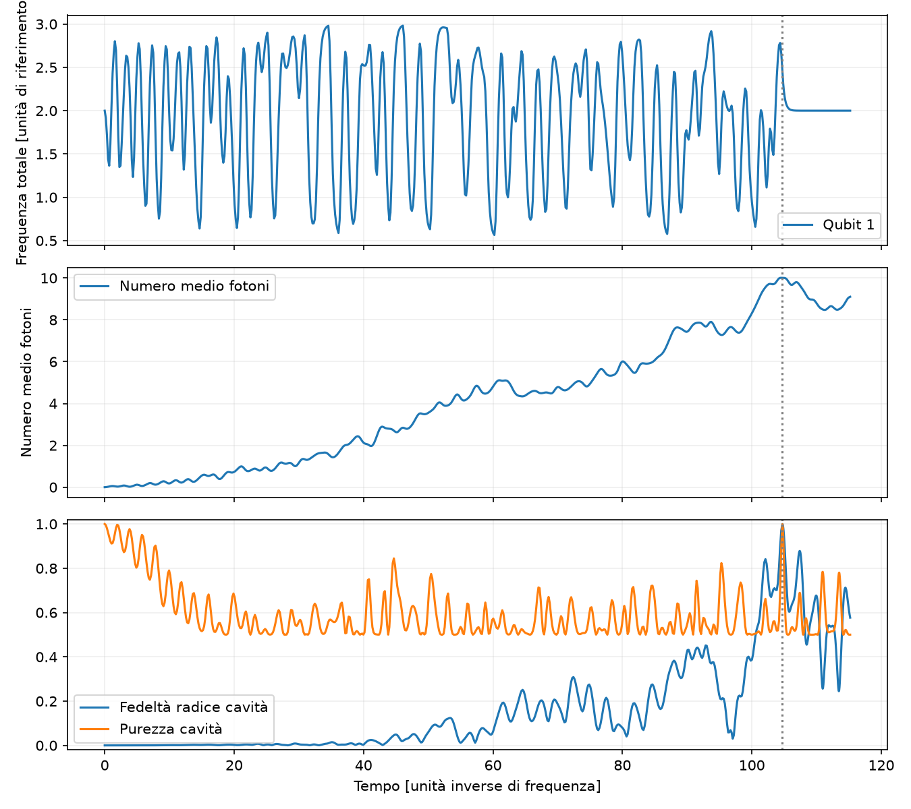
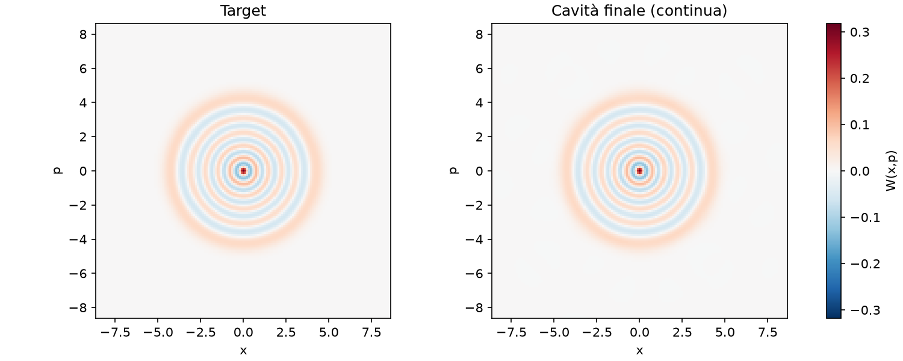
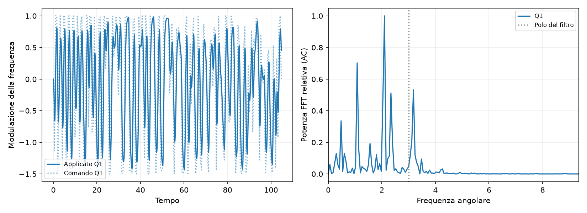
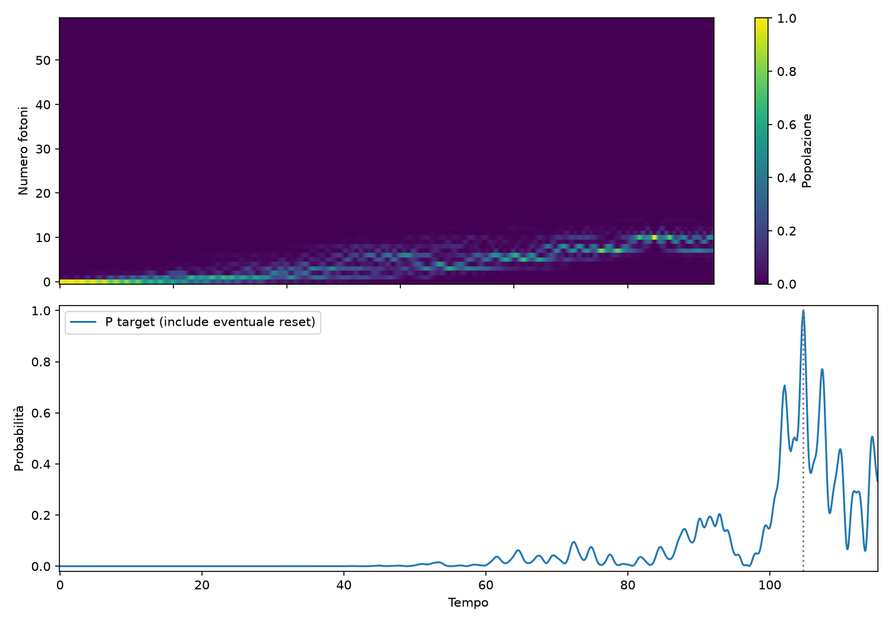

## 2q_normalized_independent
Distribuzione sulle 2 pipeline raffinate: {"count": 2, "probability_mean": 0.9971413095585355, "probability_std_population": 0.0016558560585770987, "probability_median": 0.9971413095585355, "probability_min": 0.9954854534999584, "probability_max": 0.9987971656171126, "numerically_valid_count": 2, "validated_goal_count": 2, "validated_goal_fraction": 1.0, "probability_q25": 0.996313381529247, "probability_q75": 0.9979692375878241, "selection_bias_top_only": false}.
Seed selezionato: 100. Selezione per costo continuo, dando precedenza alle soluzioni validate.
Probabilità target senza modulazione: 0.00000000.

### random — 100
Controlli numerici falliti: nessuno.
CRAB: Maximum number of function evaluations has been exceeded.. GRAPE: STOP: TOTAL NO. OF ITERATIONS REACHED LIMIT.
[Metadati completi](2q_normalized_independent/seed_100/result.json)
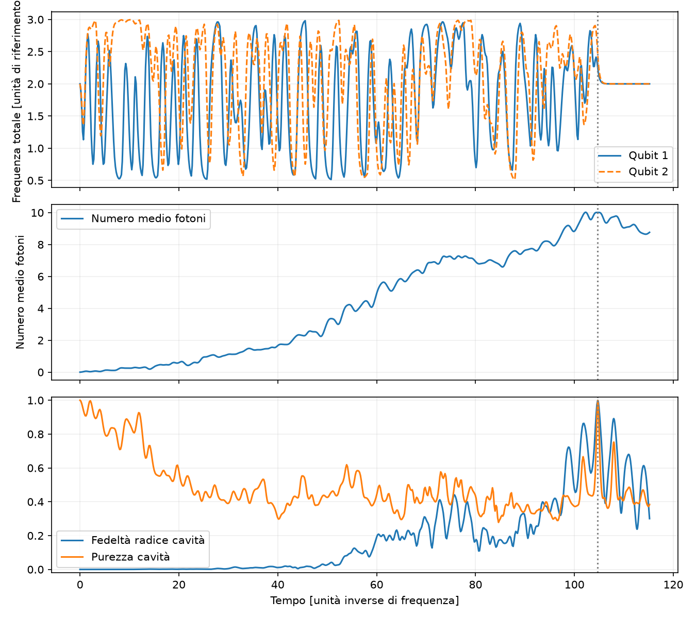

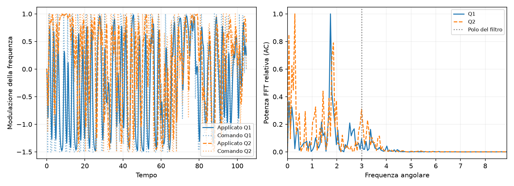

### random — 101
Controlli numerici falliti: nessuno.
CRAB: Maximum number of function evaluations has been exceeded.. GRAPE: STOP: TOTAL NO. OF ITERATIONS REACHED LIMIT.
[Metadati completi](2q_normalized_independent/seed_101/result.json)
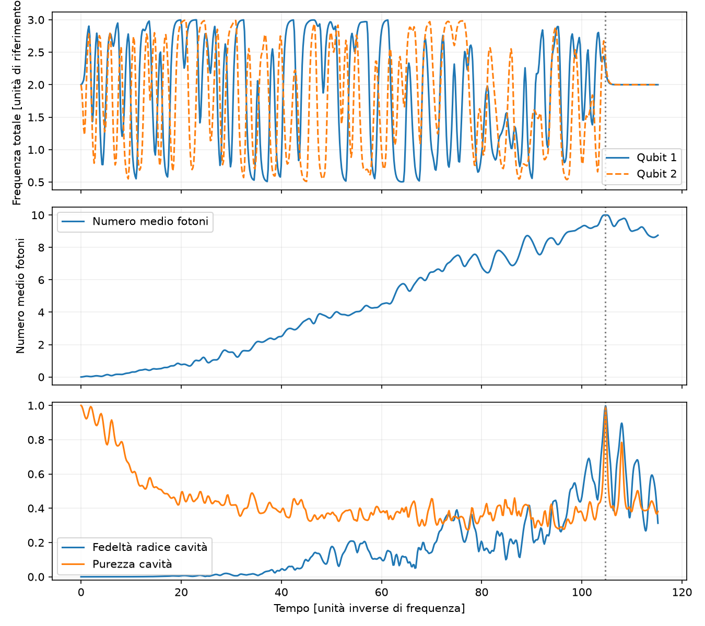
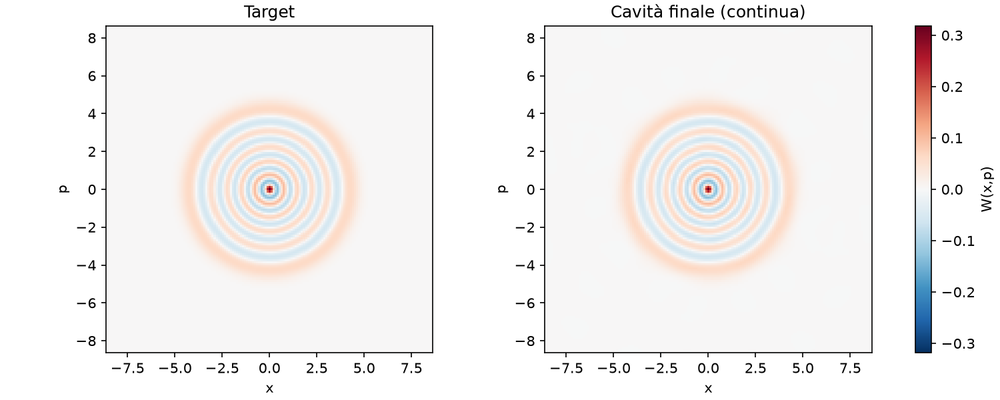
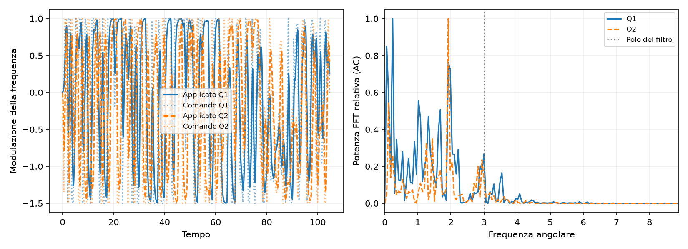
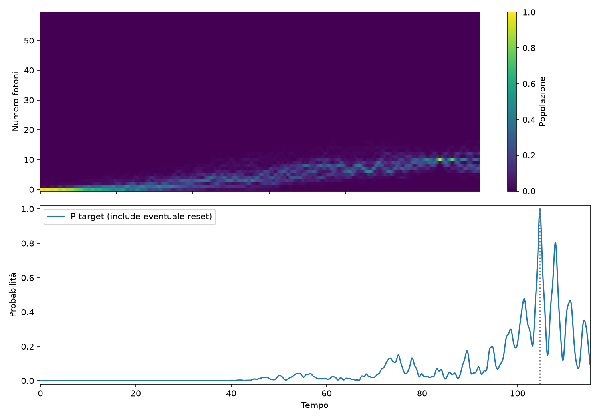
