# Risultati v2

Durata fisica T = 104.7197551. T = 20 × tau_s; tau_s = pi/(2*g_ref) = 5.235987756, g_ref = 0.3.

Ogni riga usa la propagazione continua del controllo con il filtro configurato.
P_target è la probabilità target; F_root = sqrt(P_target). Il reset dei qubit, se richiesto, entra in P_target.
Una soluzione non validata non è evidenza di vantaggio fisico. La convergenza dell'ottimizzatore è distinta dalla validazione numerica.
Le statistiche e il seed selezionato riguardano solo partenze casuali; i warm start sono separati.
La banda 99% è una diagnostica del segnale finito, non un limite spettrale imposto. Le fluenze non sono calore dissipato.

| Caso | Seed | P target | F radice | Purezza | Validato | Soglia raggiunta |
|---|---:|---:|---:|---:|---|---|
| 1q | 100 | 0.99936121 | 0.99968056 | 0.999353 | True | True |
| 1q | 101 | 0.99931849 | 0.99965919 | 0.999275 | True | True |
| 2q_normalized_independent | 100 | 0.99786086 | 0.99892986 | 0.996809 | True | True |
| 2q_normalized_independent | 101 | 0.99905647 | 0.99952812 | 0.998563 | True | True |

## 1q
Distribuzione sulle 2 pipeline raffinate: {"count": 2, "probability_mean": 0.9993398506030495, "probability_std_population": 2.1363468251489603e-05, "probability_median": 0.9993398506030495, "probability_min": 0.9993184871347981, "probability_max": 0.9993612140713011, "numerically_valid_count": 2, "validated_goal_count": 2, "validated_goal_fraction": 1.0, "probability_q25": 0.9993291688689239, "probability_q75": 0.9993505323371753, "selection_bias_top_only": false}.
Seed selezionato: 100. Selezione per costo continuo, dando precedenza alle soluzioni validate.
Probabilità target senza modulazione: 0.00000000.

### random — 100
Controlli numerici falliti: nessuno.
CRAB: Maximum number of function evaluations has been exceeded.. GRAPE: STOP: TOTAL NO. OF ITERATIONS REACHED LIMIT.
[Metadati completi](1q/seed_100/result.json)
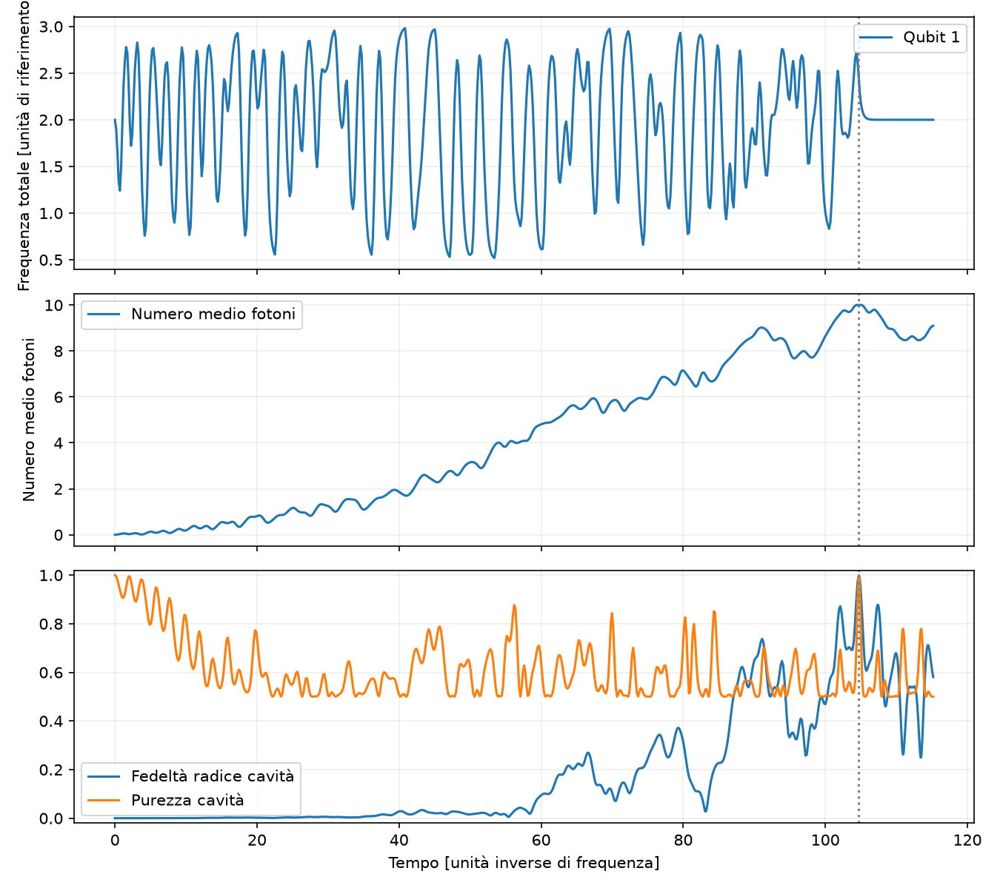

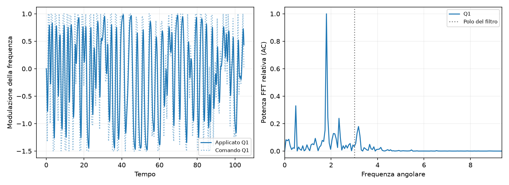
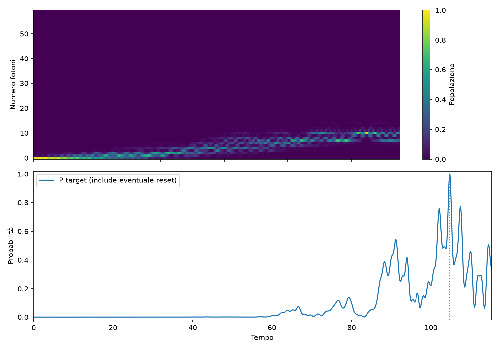

### random — 101
Controlli numerici falliti: nessuno.
CRAB: Maximum number of function evaluations has been exceeded.. GRAPE: STOP: TOTAL NO. OF ITERATIONS REACHED LIMIT.
[Metadati completi](1q/seed_101/result.json)
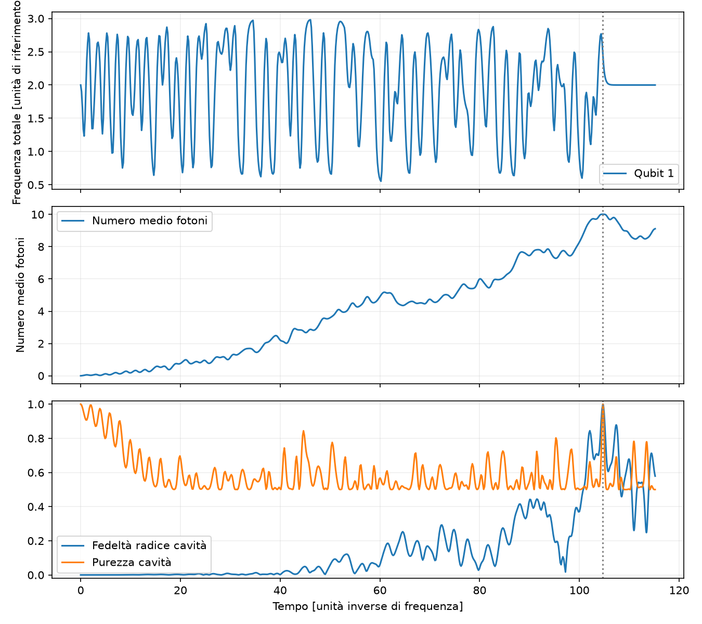

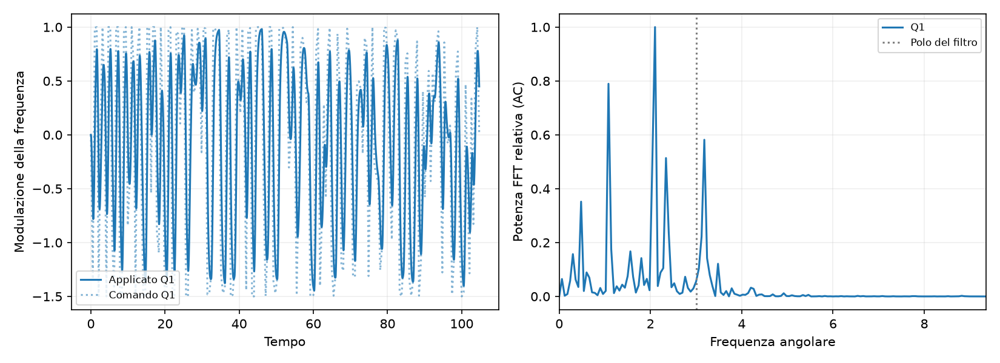
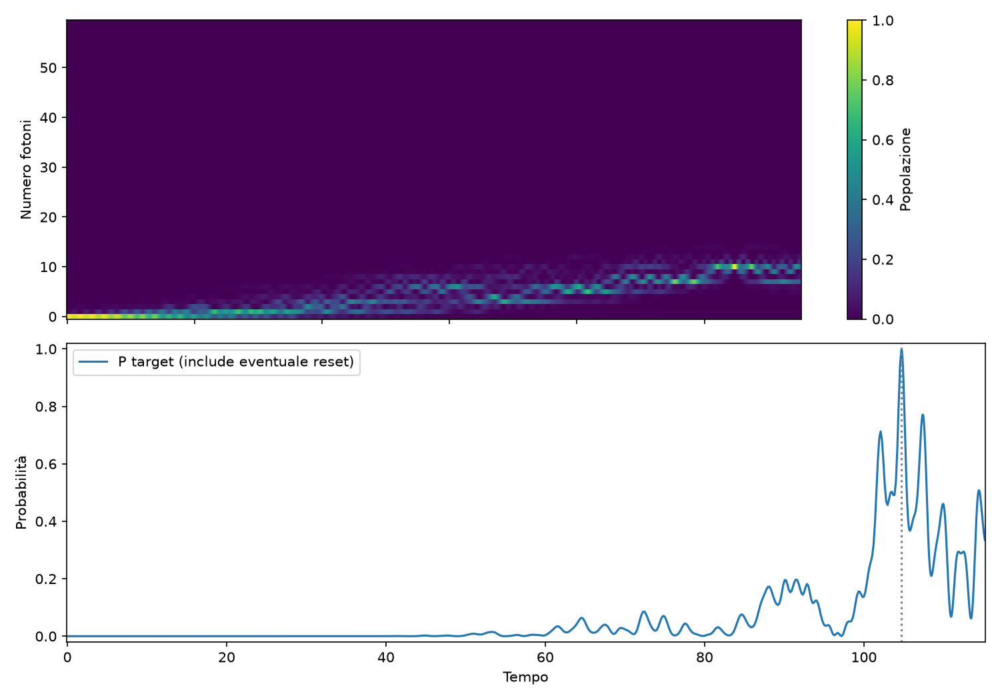

## 2q_normalized_independent
Distribuzione sulle 2 pipeline raffinate: {"count": 2, "probability_mean": 0.9984586648691898, "probability_std_population": 0.0005978034920757769, "probability_median": 0.9984586648691898, "probability_min": 0.9978608613771139, "probability_max": 0.9990564683612655, "numerically_valid_count": 2, "validated_goal_count": 2, "validated_goal_fraction": 1.0, "probability_q25": 0.9981597631231518, "probability_q75": 0.9987575666152276, "selection_bias_top_only": false}.
Seed selezionato: 101. Selezione per costo continuo, dando precedenza alle soluzioni validate.
Probabilità target senza modulazione: 0.00000000.

### random — 100
Controlli numerici falliti: nessuno.
CRAB: Maximum number of function evaluations has been exceeded.. GRAPE: STOP: TOTAL NO. OF ITERATIONS REACHED LIMIT.
[Metadati completi](2q_normalized_independent/seed_100/result.json)
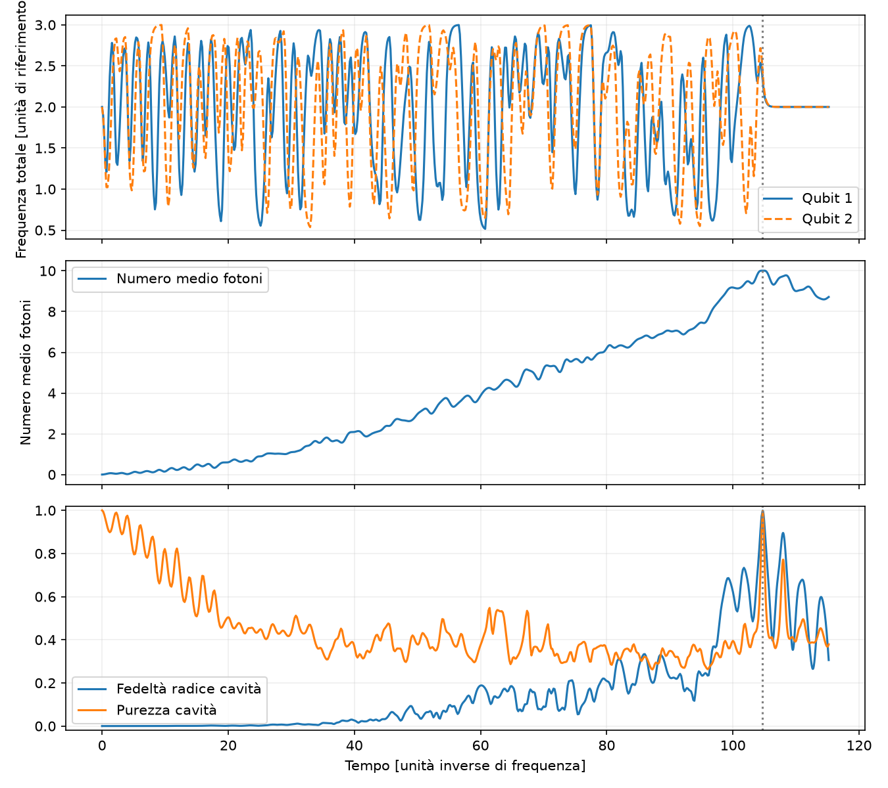
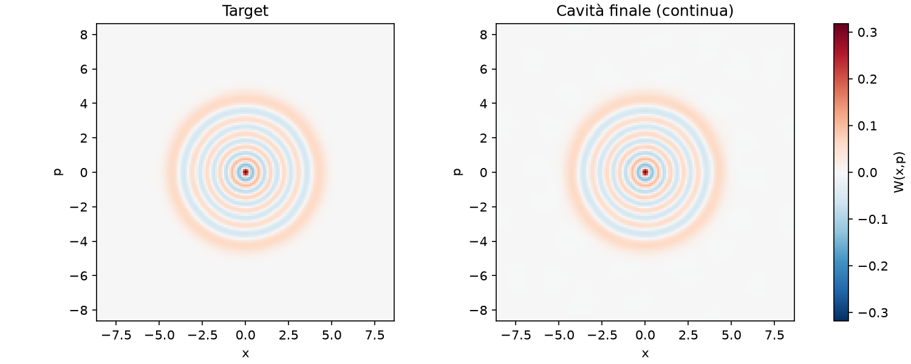
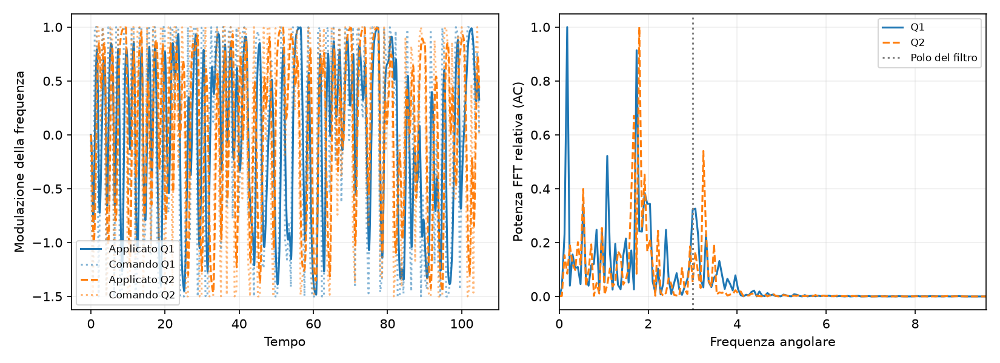

### random — 101
Controlli numerici falliti: nessuno.
CRAB: Maximum number of function evaluations has been exceeded.. GRAPE: STOP: TOTAL NO. OF ITERATIONS REACHED LIMIT.
[Metadati completi](2q_normalized_independent/seed_101/result.json)
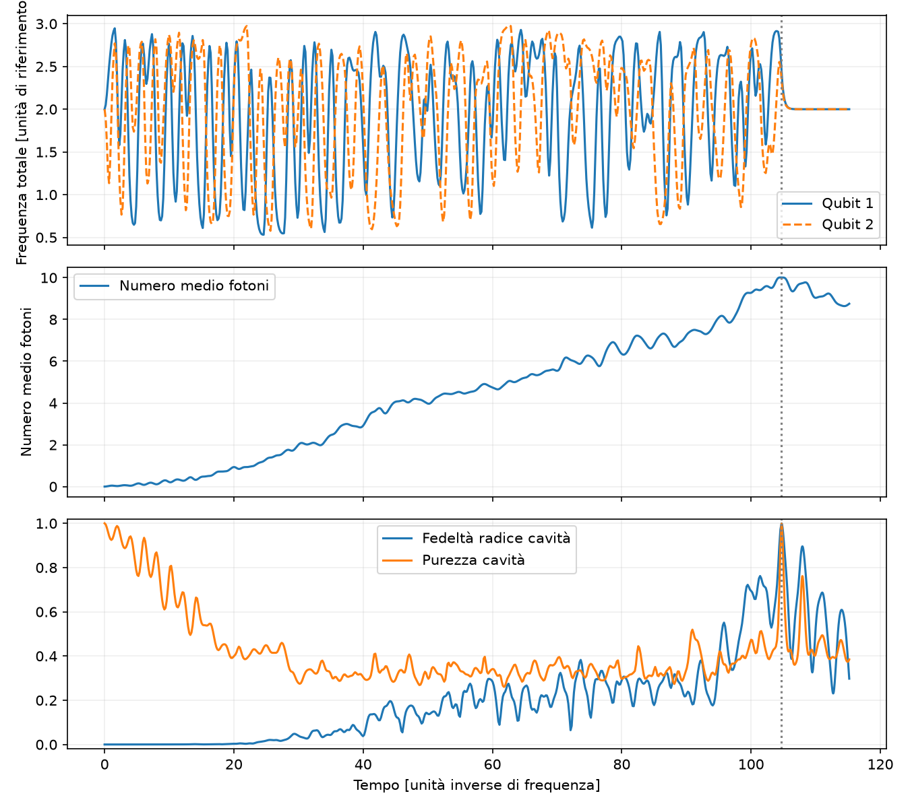
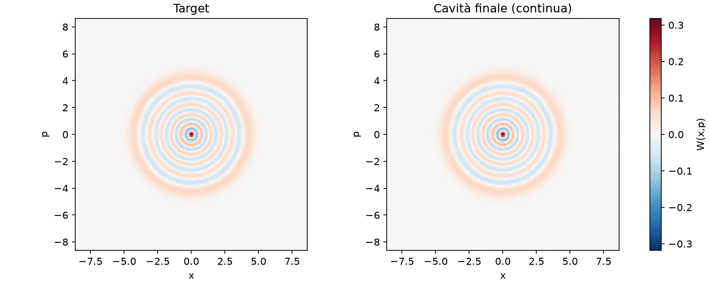
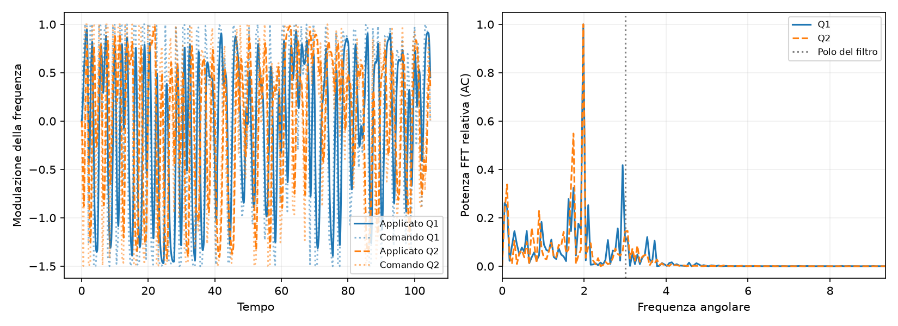

